# Práctica 4: Gestión de archivos multiplataforma (Android e iOS)

**Instituto Politécnico Nacional · Escuela Superior de Cómputo**
Ingeniería en Sistemas Computacionales (plan 2020) · Desarrollo de aplicaciones móviles nativas
Autor: Javier Gámez · Entrega: jueves 5 de noviembre de 2026

## Índice
1. [Introducción](#1-introducción)
2. [Tecnología, versiones y dependencias](#2-tecnología-versiones-y-dependencias)
3. [Estructura del repositorio](#3-estructura-del-repositorio)
4. [Compilación y ejecución (Android e iOS)](#4-compilación-y-ejecución-android-e-ios)
5. [Desarrollo (descripción técnica y capturas)](#5-desarrollo-descripción-técnica-y-capturas)
6. [Implementación](#6-implementación)
7. [Pruebas realizadas y matriz de pruebas](#7-pruebas-realizadas-y-matriz-de-pruebas)
8. [Estado actual y limitaciones](#8-estado-actual-y-limitaciones)
9. [Conclusiones](#9-conclusiones)
10. [Bibliografía](#10-bibliografía-apa)

---

## 1. Introducción

Se desarrollaron dos aplicaciones móviles con **Flutter (Dart)**, ambas con objetivos **Android e iOS** y 100 % funcionales sin conexión a Internet:

| Parte | Carpeta | Descripción |
|---|---|---|
| 1 | `Practica4-KMP-Flutter/parte1_gestor_archivos/` | **Gestor de archivos**: explora el espacio propio de la app y las carpetas/archivos que el usuario autoriza con el selector del sistema; visores de texto, JSON/XML con resaltado de sintaxis e imágenes con zoom y rotación; metadatos, recientes, favoritos persistentes, caché de miniaturas y operaciones copiar/mover/renombrar/eliminar. |
| 2 | `Practica4-KMP-Flutter/parte2_juego/` | **Apagón**, juego de puzzle original (tablero de luces) con 2 niveles (3x3 y 5x5), puntuación, progreso, efectos visuales, sonido y vibración, y guardado/carga de partidas en **TXT, XML y JSON**. |

Ambas aplicaciones incluyen los temas **Guinda (IPN)** y **Azul (ESCOM)** y se adaptan automáticamente al modo **claro/oscuro** del sistema.

**Tecnología elegida:** Flutter para las dos partes (el PDF permite elegir una sola tecnología: Kotlin Multiplatform o Flutter).

## 2. Tecnología, versiones y dependencias

| Elemento | Versión / valor |
|---|---|
| Flutter / Dart | 3.47.2 / 3.13.2 (equipo local, Android); 3.47.9 / 3.13.7 (Codemagic, iOS) — canal stable |
| Android mínimo | API 24 (Android 7.0) — `minSdk = 24` en ambas apps |
| Android probado | **Android 14**, Samsung SM-G998U (dispositivo físico, USB) |
| iOS mínimo | iOS 15.0 (`IPHONEOS_DEPLOYMENT_TARGET = 15.0`) |
| iOS probado | **Simulador de iPhone** en Codemagic (`mac_mini_m2`): **Xcode 26.6** (build 17F113), CocoaPods 1.16.2, Flutter 3.47.9 / Dart 3.13.7 (versión del CI), runtime de iOS incluido con Xcode 26.6 (el número exacto del runtime no se leyó del log). Capturas de 1206x2622 px. |
| Paquetes (ambas) | `path_provider`, `file_picker`, `shared_preferences`, `share_plus`, `path`, `xml`; `integration_test` (desarrollo) |
| Paquetes (solo Parte 1) | `mime`, `open_filex` |

**Permisos y seguridad:** no se declara `READ/WRITE_EXTERNAL_STORAGE` ni `MANAGE_EXTERNAL_STORAGE`. El manifiesto principal no declara `INTERNET` (sólo los manifiestos `debug`/`profile` de Flutter lo incluyen para depuración) y el código no realiza llamadas de red.

## 3. Estructura del repositorio

```
.
├── README.md                      ← este documento
├── codemagic.yaml                 ← CI: compila y prueba ambas apps en simulador iOS
└── Practica4-KMP-Flutter/
    ├── capturas/                  ← evidencia (Android: p?_android_*, iOS: p?_ios_*)
    ├── parte1_gestor_archivos/
    │   ├── lib/                   ← main, home, viewers, storage, theme
    │   ├── integration_test/      ← prueba de integración con capturas
    │   ├── test_driver/
    │   ├── android/  ios/
    └── parte2_juego/
        ├── lib/                   ← main, pages, model, theme
        ├── test/                  ← pruebas unitarias de serialización
        ├── integration_test/  test_driver/
        ├── android/  ios/
```

## 4. Compilación y ejecución (Android e iOS)

### Android (Windows / macOS / Linux)
Requisitos: Flutter 3.47+, Android SDK (API 24+), depuración USB o emulador.
```bash
cd Practica4-KMP-Flutter/parte1_gestor_archivos   # o parte2_juego
flutter pub get
flutter run                  # emulador o dispositivo
flutter build apk --debug    # build/app/outputs/flutter-apk/app-debug.apk
```

### iOS (requiere macOS + Xcode)
Preparación de Xcode: instalar Xcode y *Command Line Tools*, aceptar la licencia (`sudo xcodebuild -license`), instalar CocoaPods (`brew install cocoapods`), abrir un simulador (`open -a Simulator`) y comprobar con `flutter doctor`.
```bash
cd Practica4-KMP-Flutter/parte1_gestor_archivos   # o parte2_juego
flutter pub get
open ios/Runner.xcworkspace   # Signing & Capabilities: elegir Team (sólo para dispositivo real); Deployment Target 15.0
flutter run -d <simulador-o-iPhone>
```
En `ios/Runner/Info.plist` de ambas apps se añadieron `UIFileSharingEnabled` y `LSSupportsOpeningDocumentsInPlace` para que el sandbox sea visible en la app *Archivos*.

### iOS sin Mac ni iPhone: Codemagic
`codemagic.yaml` define dos workflows (`ios-parte1-gestor`, `ios-parte2-juego`) que, en una Mac en la nube: instalan dependencias, analizan el código (y ejecutan `flutter test` en la Parte 2), arrancan un **simulador de iPhone**, ejecutan la misma prueba de integración que en Android guardando capturas como artefactos, y compilan `Runner.app` para el simulador. No requieren firma ni cuenta de Apple Developer. Se inician en Codemagic → la app → *Start new build* → workflow y rama `main`.

### Ejecutar las pruebas
```bash
cd Practica4-KMP-Flutter/parte2_juego && flutter test                      # pruebas unitarias (10)
flutter drive --driver=test_driver/integration_test.dart \
  --target=integration_test/app_test.dart -d <id-dispositivo>              # integración + capturas en ./screenshots
```

## 5. Desarrollo (descripción técnica y capturas)

### Parte 1 – Gestor de archivos
Explora el **espacio privado de la app** (sandbox) y las carpetas/archivos que el usuario elige mediante el selector del sistema, sin asumir acceso irrestricto. Navegación con *breadcrumbs*, miniaturas con caché, recientes y favoritos persistentes, y operaciones con validación de permisos y confirmación de acciones destructivas.

| Android 14 (físico) | iOS (simulador) |
|---|---|
| 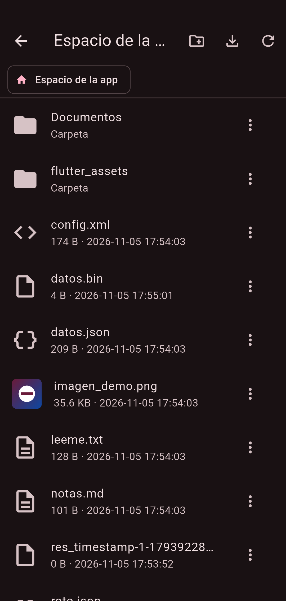 | 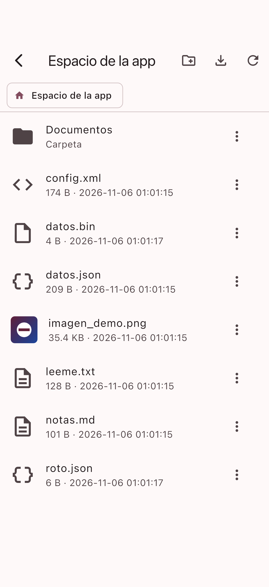 |
| Explorador con miniaturas y metadatos | Explorador |
| 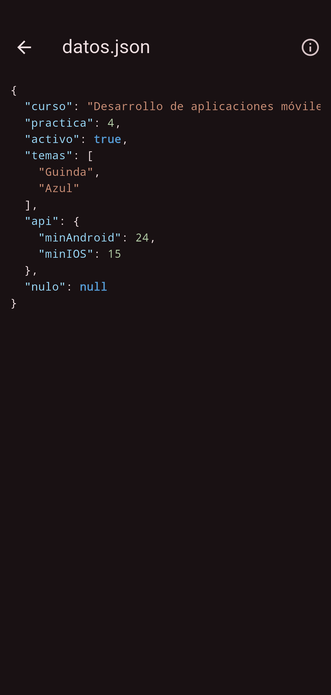 | 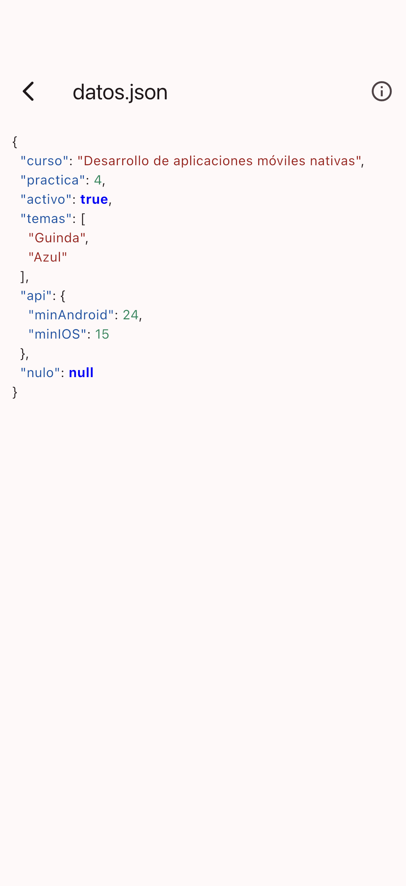 |
| JSON con resaltado de sintaxis | JSON con resaltado (modo claro) |
|  |  |
| XML con resaltado | XML con resaltado |
|  |  |
| Imagen con zoom y rotación | Imagen rotada |
| 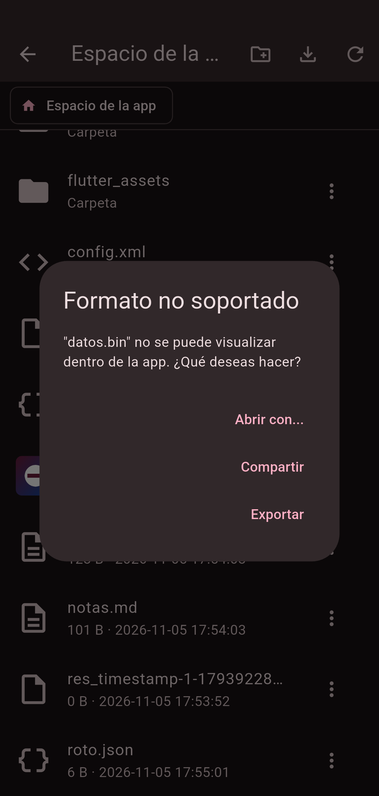 | 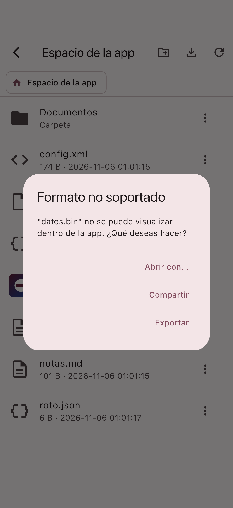 |
| Formato no soportado: abrir / compartir / exportar | Formato no soportado |
| 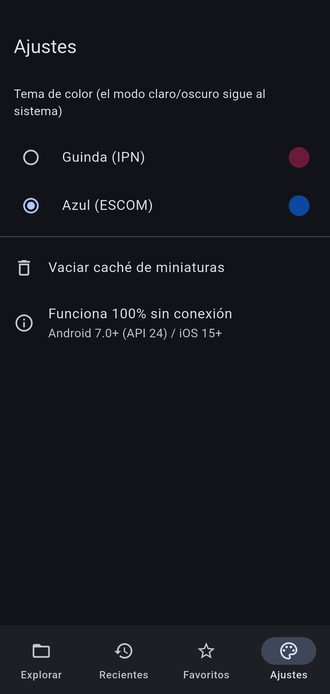 | 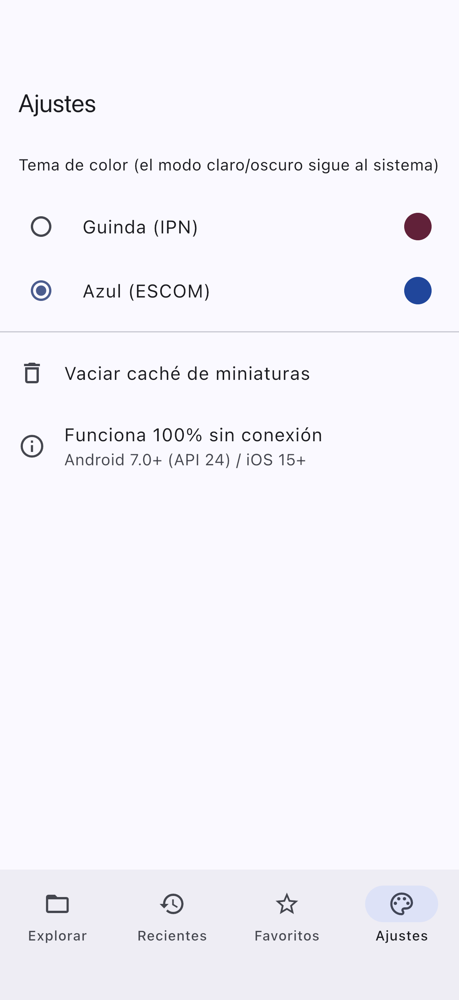 |
| Tema Azul (ESCOM) | Tema Azul (ESCOM) |

Vista horizontal — Android: 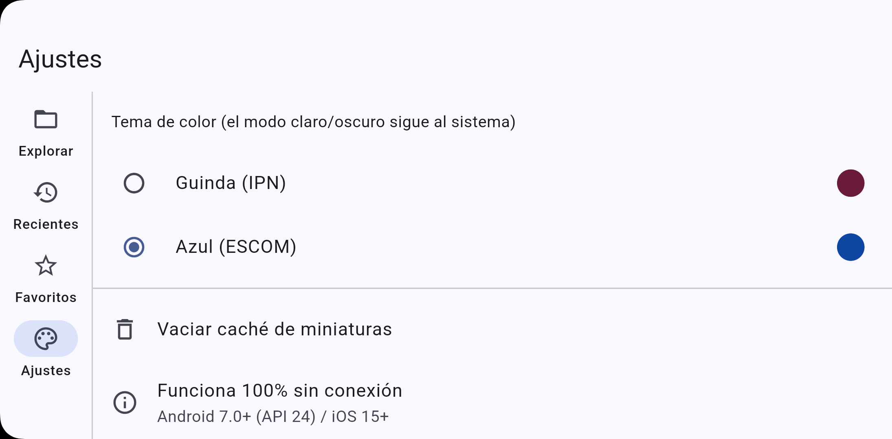 · iOS: 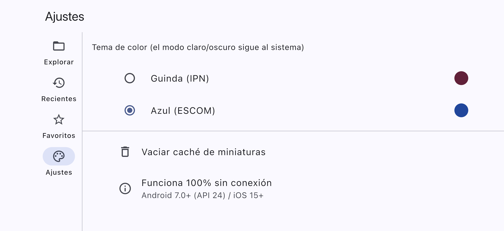

### Parte 2 – Apagón (juego con gestión de archivos)
**Reglas:** al tocar una luz se invierte su estado y el de sus 4 vecinas; se gana apagándolas todas. Nivel 1 "Chispa" (3x3) y Nivel 2 "Tormenta" (5x5, se desbloquea al ganar el 1). Puntos = `tamaño·400 − 10·movimientos − segundos`. Los tableros se generan aplicando toques aleatorios a un tablero apagado, por lo que siempre tienen solución. Incluye deshacer, brillo animado, sonido del sistema y vibración.

**Archivos:** se guarda estado del tablero, puntuación, tiempo, configuraciones (sonido, vibración, contador, tema) e historial de movimientos, en **.txt, .xml o .json** (formato elegible), por defecto en el almacenamiento privado de la app. Las partidas se listan con metadatos, se pueden etiquetar, ver, exportar, compartir, importar y eliminar. Archivos vacíos, incompletos o corruptos se marcan como "Dañada" sin afectar a las demás.

| Android 14 (físico) | iOS (simulador) |
|---|---|
| 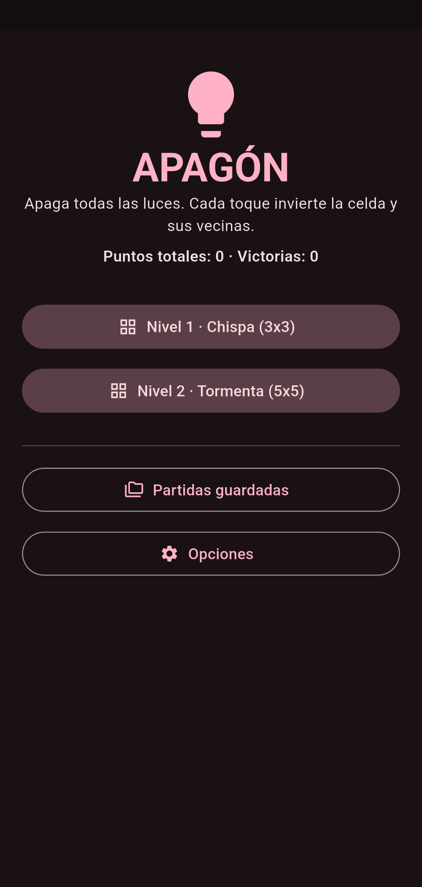 | 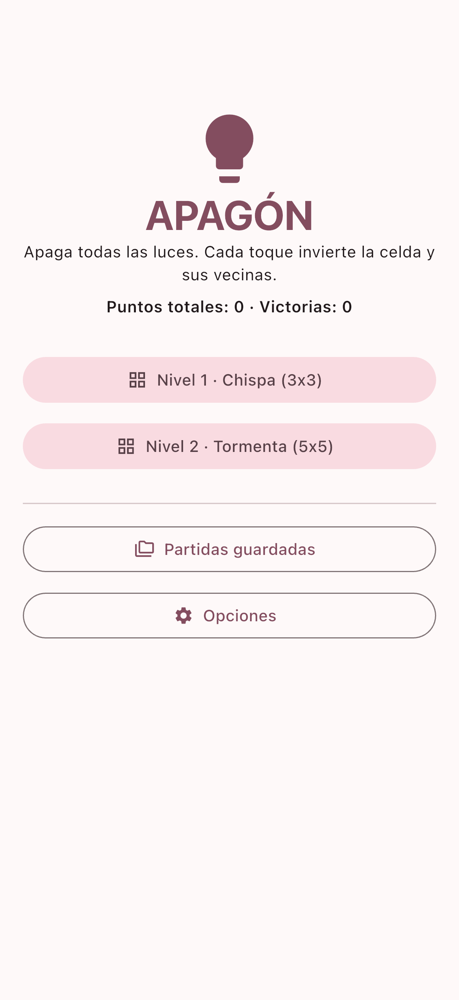 |
| Menú principal | Menú principal |
| 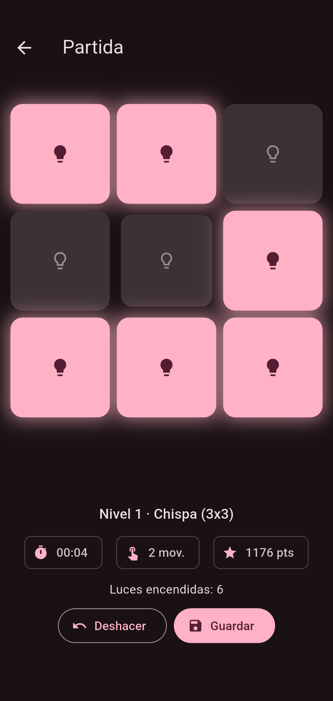 | 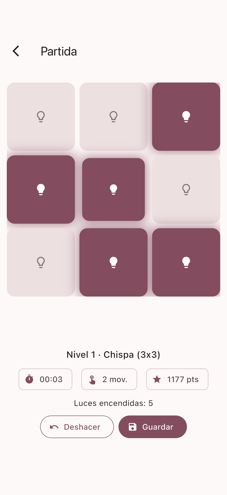 |
| Partida (nivel 1) | Partida (nivel 1) |
| 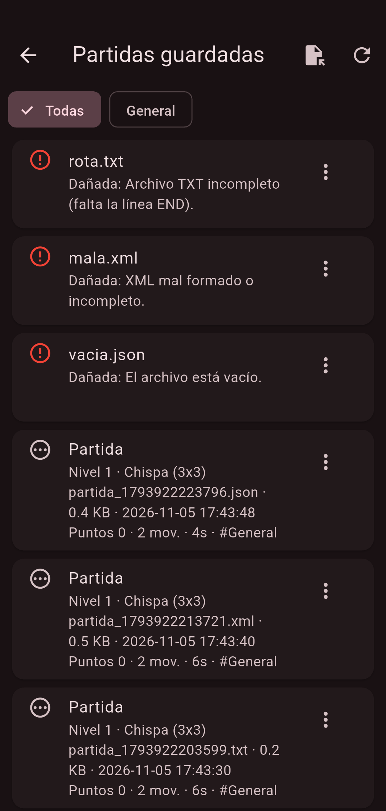 | 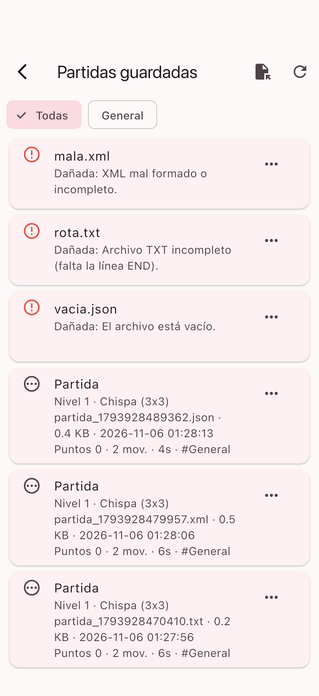 |
| Partidas guardadas (3 formatos + 3 dañadas) | Partidas guardadas |
| 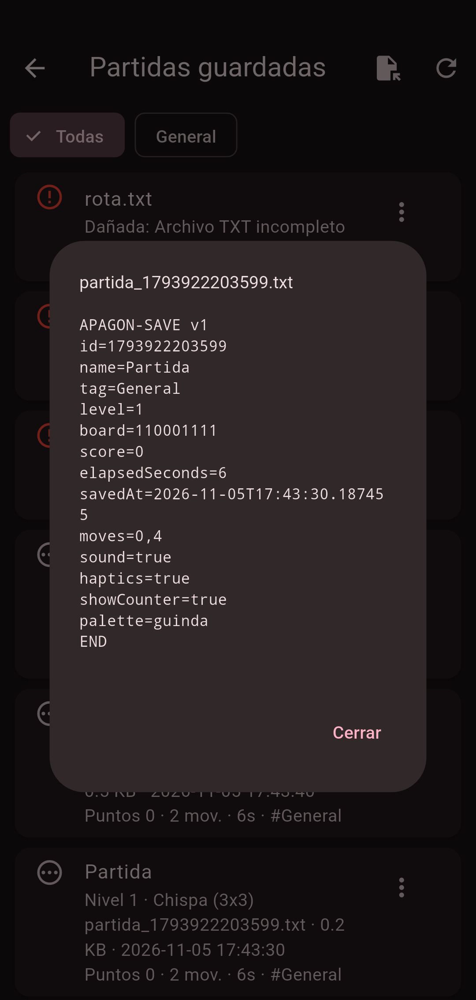 | 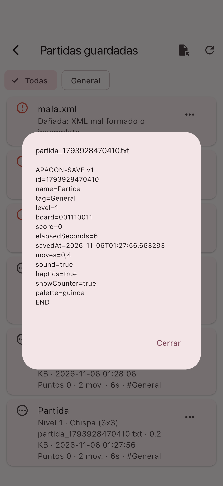 |
| Ver contenido de un archivo de guardado | Ver contenido |
| 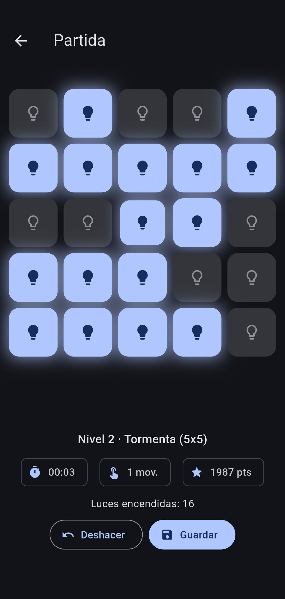 | 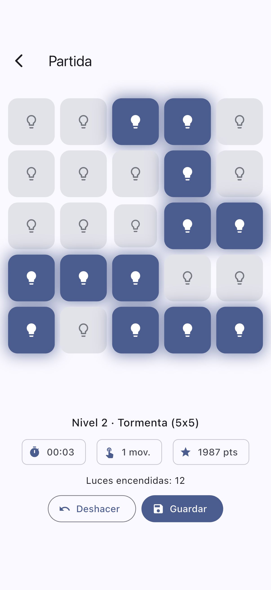 |
| Nivel 2 (5x5), tema Azul | Nivel 2 (5x5) |

Vista horizontal (Android): 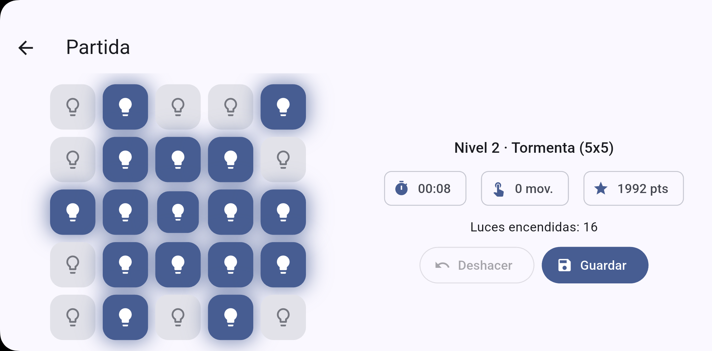
Modo avión + modo claro (Android): 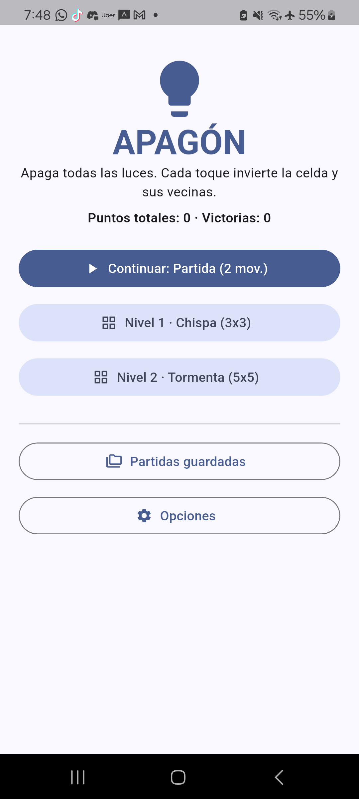

## 6. Implementación

### Arquitectura compartida
Toda la lógica y la UI están en Dart (un único código para ambos sistemas). No se escribió código nativo propio: las diferencias de plataforma las resuelven plugins que llaman a las APIs nativas.

| Necesidad | Paquete / API | Android | iOS |
|---|---|---|---|
| Espacio privado | `path_provider` | `filesDir` / `cacheDir` | `Documents` / `Caches` del sandbox |
| Selector de archivos/carpetas | `file_picker` | Storage Access Framework (`ACTION_OPEN_DOCUMENT(_TREE)`) | `UIDocumentPickerViewController` |
| Exportar | `FilePicker.saveFile` | `ACTION_CREATE_DOCUMENT` | Document picker (exportar) |
| Compartir | `share_plus` | `Intent.ACTION_SEND` | `UIActivityViewController` |
| Abrir con otra app | `open_filex` | `Intent.ACTION_VIEW` | `UIDocumentInteractionController` |
| Preferencias (tema, recientes, favoritos, opciones) | `shared_preferences` | `SharedPreferences` | `NSUserDefaults` |

**Código específico por plataforma:** sólo configuración (`minSdk = 24` y manifiestos en Android; `Info.plist` y deployment target 15.0 en iOS). La lógica es común.

### Parte 1 (`parte1_gestor_archivos/lib`)
* `main.dart` – arranque, temas y siembra de archivos de ejemplo.
* `home.dart` – navegación responsiva (`NavigationBar` en vertical, `NavigationRail` en pantallas ≥ 700 dp), raíces autorizadas, navegador con *breadcrumbs*, operaciones de archivo y diálogo de formatos no soportados.
* `viewers.dart` – visor de texto, resaltado propio de JSON y XML (formateo con `jsonEncode` indentado y paquete `xml`), visor de imágenes (`InteractiveViewer` + rotación) y metadatos (indica *No disponible* cuando un dato falta).
* `storage.dart` – `Prefs` (persistencia) y `ThumbCache` (miniaturas en memoria y disco; la clave incluye ruta + tamaño + fecha de modificación y se invalida sola).

**Seguridad (Scoped Storage / sandbox):** el acceso a ubicaciones externas ocurre sólo tras un diálogo que explica la finalidad y mediante el selector del sistema; si se cancela, se respeta. Antes de escribir se valida el destino (archivo de prueba), se confirman las acciones destructivas y se manejan ruta inexistente, permiso revocado, lectura fallida y almacenamiento lleno (errno 28) sin bloquear la app.

### Parte 2 (`parte2_juego/lib`)
* `model.dart` – `GameState`, serializadores/parsers y `Store`.
* `pages.dart` – menú, partida, partidas guardadas y opciones.

**Serialización (misma información en los tres formatos):**
* **TXT:** líneas `clave=valor` con encabezado `APAGON-SAVE v1` y cierre `END`; sin la línea `END` se considera incompleto.
* **XML:** documento `<partida juego="Apagon" version="1">` con `<id>`, `<name>`, `<tag>`, `<level>`, `<board>`, `<score>`, `<elapsedSeconds>`, `<savedAt>`, `<settings>` y `<moves><m>…</m></moves>`, generado y leído con el paquete `xml`.
* **JSON:** objeto con los mismos campos (`jsonEncode` indentado).

**Persistencia robusta:** escritura atómica (se escribe `.tmp` y se renombra), autoguardado al pasar a segundo plano y botón **Continuar** que recupera la partida más reciente. Cada parser valida el contenido y lanza un error legible (`SaveFormatError`) ante archivos vacíos, truncados, con campos faltantes o valores inválidos.

## 7. Pruebas realizadas y matriz de pruebas

**Pruebas automáticas.**
* *Unitarias* (`flutter test`, Parte 2): ida y vuelta TXT/XML/JSON, archivo vacío y archivo truncado en cada formato → 10/10 aprobadas.
* *Integración* (`integration_test/app_test.dart` en cada app): recorren la app y toman capturas con nombre fijo. Se ejecutaron en **Android (dispositivo físico)** y en **iOS (simulador, Codemagic)**; en ambos pasaron.

**Matriz de pruebas** (las filas pendientes no se han ejecutado y se indican como tales):

| # | SO / versión / dispositivo | Pasos | Resultado esperado | Resultado obtenido | Evidencia |
|---|---|---|---|---|---|
| 1 | Android 14 · Samsung SM-G998U, **modo avión activo** | Abrir las apps sin Internet; P2: continuar la partida guardada | Funciona sin conexión | Correcto en P2 (abre y recupera la partida; ícono de avión visible). P1 abrió sin errores, sin captura. Además, el manifiesto principal no declara `INTERNET` y el código no usa red | `capturas/p2_android_avion_claro_menu.png` |
| 2 | Android 14 · Samsung SM-G998U | P1: abrir `datos.json` y `config.xml` | Formato y resaltado correctos | Correcto | `p1_android_03_json.png`, `p1_android_04_xml.png` |
| 3 | Android 14 · Samsung SM-G998U | P1: abrir imagen, girar y ver metadatos | Imagen, rotación y MIME | Correcto (`image/png`); zoom táctil no automatizado | `p1_android_06_imagen_rotada.png`, `p1_android_07_metadatos.png` |
| 4 | Android 14 · Samsung SM-G998U | P1: abrir JSON inválido | Aviso legible, sin cierre | Correcto ("JSON inválido") | `p1_android_05_json_invalido.png` |
| 5 | Android 14 · Samsung SM-G998U | P1: renombrar, copiar, mover y eliminar (con confirmación) | Operaciones correctas en disco | Correcto (verificado en el sistema de archivos) | `p1_android_09_menu_archivo.png`, `p1_android_10_elegir_destino.png`, `p1_android_11_confirmar_eliminar.png` |
| 6 | Android 14 · Samsung SM-G998U | P1: abrir archivo `.bin` | Diálogo abrir / compartir / exportar | Correcto | `p1_android_08_formato_no_soportado.png` |
| 7 | Android 14 · Samsung SM-G998U | P1: favoritos, recientes y breadcrumbs | Listados y navegación correctos | Correcto | `p1_android_12_breadcrumbs.png`, `p1_android_13_recientes.png`, `p1_android_14_favoritos.png` |
| 8 | Android 14 · Samsung SM-G998U | P2: guardar en .txt, .xml y .json | 3 archivos válidos con metadatos | Correcto (3 archivos, 2 mov. cada uno) | `p2_android_03_dialogo_guardar.png`, `p2_android_04_lista_partidas.png` |
| 9 | Android 14 · Samsung SM-G998U | P2: cerrar la app a mitad de partida y reabrir | "Continuar" restaura el estado | Correcto | `p2_android_continuar.png` |
| 10 | Android 14 · Samsung SM-G998U | P2: archivo vacío, TXT incompleto y XML mal formado | Error legible; otras partidas intactas | Correcto: 3 "Dañada" y 3 válidas | `p2_android_04_lista_partidas.png` |
| 11 | Android 14 · Samsung SM-G998U | P2: nivel 2, deshacer y tema Azul | 5x5; deshacer revierte; tema azul | Correcto | `p2_android_08_nivel2.png`, `p2_android_06_opciones_azul.png` |
| 12 | Android 14 · Samsung SM-G998U | Modo claro del sistema y orientación horizontal (ésta forzada desde la prueba) | UI adaptada | Correcto: modo claro (P2); en horizontal P1 muestra `NavigationRail` y P2 tablero y panel lado a lado | `p2_android_avion_claro_menu.png`, `p1_android_16_horizontal.png`, `p2_android_09_horizontal.png` |
| 13 | iOS · simulador de iPhone (Codemagic) | P1: prueba de integración completa (explorar, JSON/XML, imagen, metadatos, formato no soportado, renombrar/copiar/eliminar, favoritos, recientes, breadcrumbs, tema Azul) | Pasa en iOS y genera capturas | Correcto: build verde, 15/15 capturas | `p1_ios_01_explorar.png` … `p1_ios_15_tema_azul.png` |
| 14 | iOS · simulador de iPhone (Codemagic) | P2: prueba de integración (3 formatos, archivos dañados, tema Azul, nivel 2, deshacer) | Pasa en iOS y genera capturas | Correcto: build verde, 8/8 capturas; 3 partidas válidas y 3 "Dañada" | `p2_ios_01_menu.png` … `p2_ios_08_nivel2.png` |
| 15 | Android / iOS | Selector del sistema: "Elegir carpeta", "Abrir archivo(s)" (P1), exportar y compartir (P2) | Funciona con SAF / Document Picker; respeta cancelación | **Pendiente** (requiere interacción manual con pantallas del sistema) | — |
| 16 | iOS · simulador de iPhone (Codemagic, Xcode 26.6) | Orientación horizontal | UI adaptada | P1 correcto: aparece el `NavigationRail` lateral. P2: **pendiente** de descargar la captura del build | `p1_ios_16_horizontal.png` |

## 8. Estado actual y limitaciones

* **Android:** compilado y probado en dispositivo físico con pruebas de integración automáticas.
* **iOS:** compilado y probado en el **simulador de iPhone** de Codemagic (macOS + Xcode); ambos workflows terminaron en verde y sus capturas están en `Practica4-KMP-Flutter/capturas/` (`p1_ios_*`, `p2_ios_*`). No se probó en un iPhone físico (requeriría firma con cuenta de Apple Developer), aunque el PDF admite simulador.
* **Pendiente de verificar a mano:** el flujo completo de los selectores del sistema (elegir carpeta/archivos, exportar, compartir) y la captura horizontal de la Parte 2 en iOS (filas 15 y 16).
* La fecha de creación no la expone `dart:io` en Android/iOS: se muestra "No disponible".
* Copiar y mover carpetas completas no está implementado (sólo archivos).
* En Android 11+ el selector de carpetas devuelve rutas de árbol SAF limitadas; si el sistema no permite listarlas, la app muestra un aviso y no se bloquea.
* El sonido usa los sonidos del sistema (`SystemSound`) y vibración; no se incluyeron archivos de audio propios.

## 9. Conclusiones

Flutter permitió mantener un único código para ambos sistemas y delegar en plugins las APIs nativas de acceso seguro (Storage Access Framework y Document Picker), lo que permitió centrarse en respetar el modelo de seguridad de cada sistema: usar el espacio privado por defecto, acceder a ubicaciones externas sólo con selectores del sistema, validar los destinos y manejar cada fallo con mensajes claros.

Dos aprendizajes prácticos: (1) un formato de guardado debe validar siempre su entrada (vacía, truncada, campos inválidos) para que un archivo corrupto nunca afecte al resto de partidas; y (2) sin una Mac, un servicio de CI con simuladores (Codemagic) más pruebas de integración con capturas permiten obtener evidencia reproducible en iOS.

## 10. Bibliografía (APA)

* Android Developers. (s. f.). *Access documents and other files from shared storage*. https://developer.android.com/training/data-storage/shared/documents-files
* Apple Inc. (s. f.). *UIDocumentPickerViewController*. https://developer.apple.com/documentation/uikit/uidocumentpickerviewcontroller
* Codemagic. (s. f.). *Flutter testing and building with codemagic.yaml*. https://docs.codemagic.io/flutter-configuration/flutter-projects/
* Flutter. (s. f.). *Flutter documentation*. https://docs.flutter.dev
* Flutter. (s. f.). *Integration testing*. https://docs.flutter.dev/testing/integration-tests
* JetBrains. (s. f.). *Kotlin Multiplatform*. https://kotlinlang.org/docs/multiplatform.html
